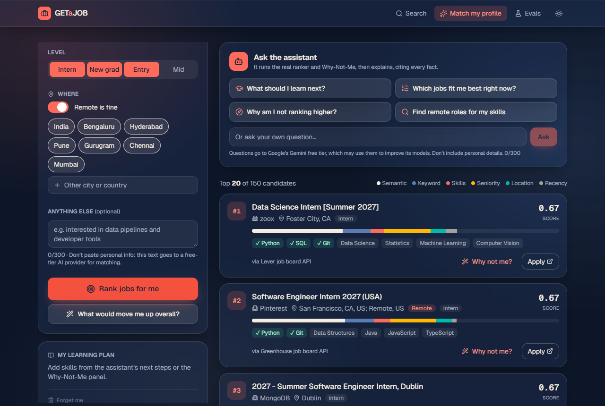
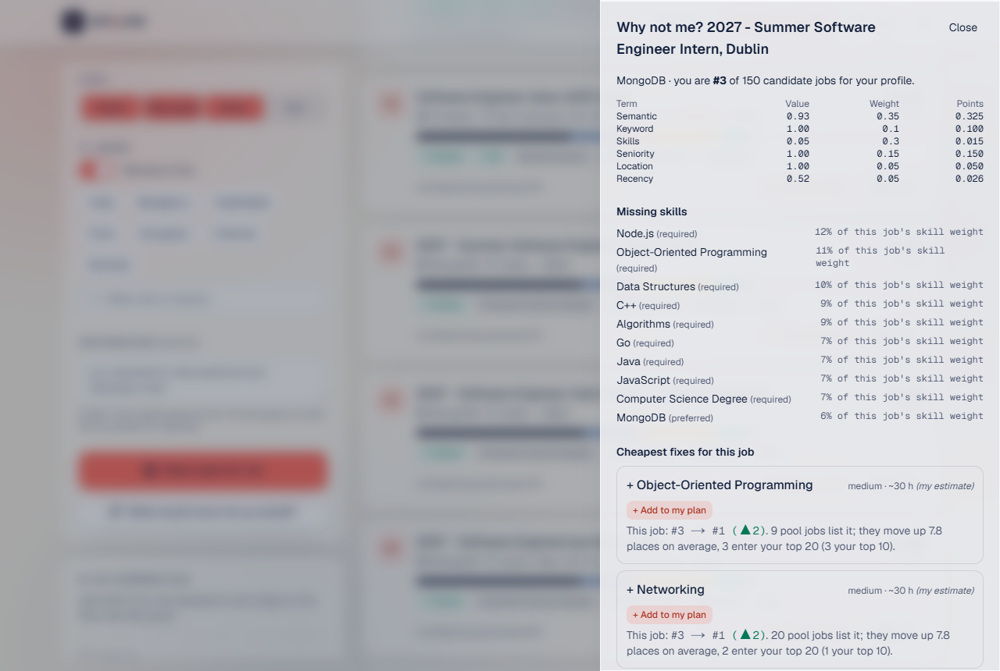
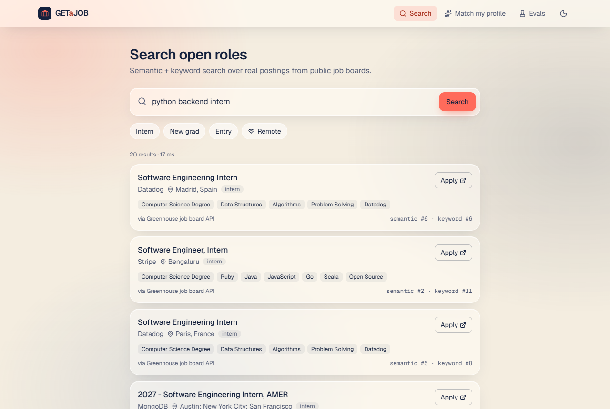
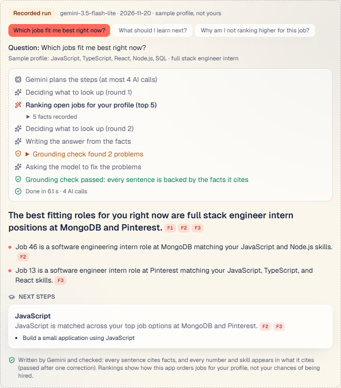
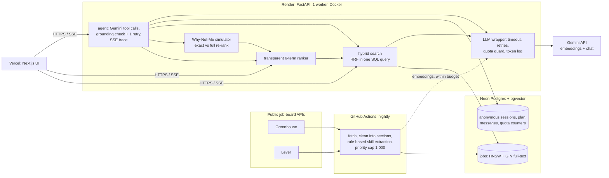

# GETaJOB

Job matching for students over **real open postings**, with a transparent ranker and a signature
feature, **Why-Not-Me**: for any job it simulates the real ranker with extra skills added. A real output,
on the 150-job fixture snapshot for a profile with Python, SQL, pandas, Git and JavaScript targeting data/backend
internships: *"Data Science Intern: adding NumPy, R and Keras moves it from #41 to #13 (about 70 h, my
estimates)."* These are the ranker's own numbers, not a hiring prediction.

> Status: all 7 slices built: ingestion and hybrid search, free-tier deploy, ranker and Why-Not-Me, grounded
> agent with session memory, UI, evals, and CI with a recorded-run fallback. Nothing below describes a
> feature that does not exist. Known gaps are listed under [Limitations](#limitations).

**Live:** API `https://getajob-api.onrender.com` (`/health`, `/api/stats`, `/api/eval`); the web app runs on
Vercel. Both are on free tiers: the API sleeps when idle, so the first request can take up to a minute.

| Ranked jobs with a score breakdown | Why-Not-Me for one job |
|---|---|
|  |  |
| **Hybrid search** | **Recorded run, shown when the live AI is unavailable** |
|  |  |

The screenshots come from the local production build on the 150-posting snapshot. [Measured eval
numbers](#evals) are on `/eval` ([screenshot](docs/screenshots/eval.png)).

## Architecture



Every Gemini call goes through one wrapper (timeout, bounded retries, token logging, fail-closed quota
guard). When Gemini is unavailable, search falls back to full-text and the assistant to a rule-based answer.
The assistant can also replay a recorded real run, labelled as such.

## Data sources

Jobs come only from two official public APIs:

- Greenhouse Job Board API: `boards-api.greenhouse.io/v1/boards/{token}/jobs?content=true`
- Lever Postings API: `api.lever.co/v0/postings/{site}?mode=json`

Every result links to the original posting and shows which API it came from. The board list
(`backend/data/companies.yaml`) is generated by `python -m app.ingest.verify_boards`, which calls
each candidate slug and keeps only boards that answer with open jobs. The committed fixture snapshot
(`backend/data/fixtures/jobs.jsonl`) keeps only title, company, location, source URL, attribution,
extracted skills and a description excerpt of at most 600 characters. **Any posting can be removed on
request**: open an issue with the URL.

Most of the 30 verified boards are global companies; many India-based startups use other applicant
tracking systems with no public Greenhouse/Lever board, so India coverage comes mainly from global
companies' India offices and remote roles.

## How it works (slice 1)

```
companies.yaml ──> fetch (polite: User-Agent, 1 s sleep, back-off on 429/5xx)
               ──> clean HTML into headed sections
               ──> rule-based skill extraction (data/skills_taxonomy.yaml, ~380 skills + aliases;
                   Requirements -> required, Nice-to-have -> preferred, About/Benefits ignored)
               ──> seniority / remote detection ──> priority cap (MAX_ACTIVE_JOBS, default 1,000)
               ──> upsert by (source, external_id) + content_hash ──> close vanished jobs
               ──> embed only new/changed rows, highest priority first, in resumable nightly batches
Postgres + pgvector: HNSW (cosine) + GIN full-text; one SQL query fuses both with RRF.
```

- **No LLM at ingest.** Extraction is deterministic, free and re-runnable. `content_hash` covers
  only the source text, so editing the taxonomy updates skills without re-embedding anything.
- **Degrades gracefully.** No API key, mock mode or exhausted quota → full-text-only search plus a banner.
- **Quota guard.** Per-minute window on requests *and* estimated tokens (chars/4) in process, plus a
  per-day counter in Postgres (atomic, fail-closed). Limits come from env; unset → 5 RPM / 100 RPD /
  24K TPM with a warning. Quota errors stop the run cleanly; they are never retried.
- **Embedding budget split.** Ingestion may use at most `EMBED_RPD − EMBED_RESERVE_RPD` (default reserve
  250) of the daily embedding requests; the reserve is kept for live search/profile embeddings. Those are
  cached in Postgres by hash of model|dim|task|text, so a repeated query or an unchanged profile never
  costs a second call. When the quota is gone, search falls back to full-text only with a banner.

## Frontend

| Route | What it is |
|---|---|
| `/` | Landing: the name fades in once (2 s, skipped under reduced motion); Enter button, or press the Enter key; scroll down for **live** tiles (open-role count, three real searches, a live Why-Not-Me result for a sample profile, roles by level, companies, score weights). No mock data. |
| `/search` | Hybrid search with level/remote filters; `?q=` links run immediately |
| `/app` | Profile built from buttons (role presets, popular-skill toggles, level pills, location presets, remote switch) → ranked jobs with score bars → "Why not me?" panel; the assistant (preset question buttons, live trace, cited answer, "add to plan"); learning plan; Forget me. On phones: Profile / Jobs / Assistant tabs |
| `/eval` | Measured eval numbers (from `eval/results.json` via `/api/eval`), each with n, date and method; unmeasured sections say so |
| `/dev/components` | Living style guide: every token and shared primitive in both themes (not indexed) |

Navy (#14213D) / cream (#F4EDE0) / coral (#FF6B5B) with frosted-glass surfaces:
- **Two themes:** cream (light) and navy (dark), with a toggle in the header.
  - It follows the OS until you pick one, and `next-themes` applies it before paint, so there is no flash.
  - Every colour is a semantic token in `frontend/app/globals.css`, redefined for dark mode.
- **Contrast:**
  - Coral is a fill with navy text on top (`on-accent`, 5.7:1).
  - Small coral text uses a `coral-ink` token that keeps ≥ 4.5:1 in both themes.
- **Motion:** only short transitions, plus the one 2 s title fade by request. All of it is off under reduced
  motion.
- **Components:** shared primitives are hand-written and dependency-free (`components/ui.tsx`), with icons from
  lucide-react.
- **Lighthouse 13.6** (mobile emulation, local production build), measured in both themes:

| Page | Performance | Accessibility |
|---|---|---|
| `/` | 97 | 100 |
| `/app` | 95 | 100 |
| `/search` | 97 | 100 |
| `/dev/components` | 100 | 100 |

## Ranking and Why-Not-Me

**Ranker** ([scorer.py](backend/app/rank/scorer.py)): one pure, deterministic function used by every
endpoint. Candidates are the top 200 jobs from the hybrid query for the profile text; each gets

```
score = 0.35·semantic + 0.10·keyword + 0.30·skills + 0.15·seniority + 0.05·location + 0.05·recency
```

Every term is in [0, 1]; the weights live in `backend/data/ranking.yaml`, and every result carries the
per-term breakdown, which the UI shows as a stacked bar.
- `skills` = IDF-weighted share of the job's skills that the profile has (required ×1.0, preferred ×0.5).
- `semantic` is min-max normalised within the pool, and `keyword` is divided by the pool maximum.
- Ties break by job id.

**Why-Not-Me** ([engine.py](backend/app/whynot/engine.py)) re-scores the same pool with skills added:
- **Gap:** the job's missing skills, with their weight and share of that job's skill weight, plus your rank.
- **Fixes:** each missing skill that appears in at least 3 pool jobs is simulated. Results report jobs entering
  your top 10/20, the mean rank change, and the reciprocal-rank gain over the jobs that list the skill. That
  gain is not summed over the whole pool, because Σ 1/rank is the same for every ordering, so the total would
  always be zero.
- **Plan:** a greedy 3-step plan by gain per hour of effort.
  - Overall view: pool-wide gain.
  - Job view: that job's own missing skills only, taking a step only if it strictly improves that job's rank.
  - Hours come from `skills_effort.yaml` and are **my estimates**.

**What the simulation holds fixed:** the profile embedding, the retrieved pool, and the semantic and
keyword terms. Only the skill-overlap term changes, because nothing else in the score depends on skills.

**Guarantees (property-tested with Hypothesis over random pools and profiles):**
- Adding a skill never lowers any job's skill-overlap.
- No other term changes.
- Simulated scores and ranks are **bit-identical** to re-running the ranker on the extended profile.
- Results don't depend on pool order.
- A job-focused plan never leaves that job worse off.

**Known limitations:**
- Postings often list alternatives ("at least one of Go, C++, Rust or Java"). The extractor marks all of them
  as required, so the skill-overlap share underrates candidates who know one of them.
- Ranks are relative to a 200-job pool for *this* profile. Real re-retrieval after learning a skill could
  differ, because the semantic term would also move.

## The assistant (agent)

[run.py](backend/app/agent/run.py) · [tools.py](backend/app/agent/tools.py) · [grounding.py](backend/app/agent/grounding.py)

```
question ─> Gemini (function calling, ≤ 2 rounds) ─> tools over the REAL ranker
              read:  rank_jobs · best_skills · explain_job · simulate_skill · search_jobs · get_job
              write: update_plan · update_profile   (only on explicit request; taxonomy skills only)
                 │ every result becomes numbered facts: "F4: Job 17 … ranks #4 of 200 …"
                 ▼
            Gemini structured output (JSON schema): headline / points / next steps {skill, why, steps}
                 ▼
            grounding check ── pass ──> stream to the browser (SSE)
                 │ fail
                 ▼
            one retry with the violations listed ── pass ──> stream
                 │ fail
                 ▼
            rule-based narrative from the same facts (passes the same check)
```

- **Bounded:** at most 4 LLM calls per run (2 tool rounds + 1 narrative + 1 retry), and at most 3 tool calls
  per round. These are hard limits in code, and a test checks them with a model that never stops calling tools.
  Each run has a 90 s limit, with SSE keep-alive comments every 10 s.
- **Grounding check** (pure, property-tested). A sentence is kept only if:
  - it cites facts that exist;
  - every number in it appears in the facts it cites;
  - every skill it names appears in the facts it cites;
  - it has no links.
  Practice steps may also use the profile and their own skill, but nothing else. Any violation triggers one
  retry; a second failure shows the rule-based narrative. Each run's outcome (`first_try`, `after_retry`,
  `fallback`, `rules_only`) is counted anonymously per day in `events`.
- **The model never sees job descriptions,** only the facts the tools produce. The user's question is
  framed as data, not instructions.
- **Degrades instead of failing:**
  - With no key, mock mode or a quota error, the run switches to fixed rule-based steps and a rule-based
    narrative.
  - Quota errors are never retried.
  - The trace says which mode ran.
- **Daily budget:** `DAILY_MAX_RUNS = ⌊0.7 × LLM_RPD / 4⌋`, which is 70 for an RPD of 400. Worst-case agent
  calls therefore stay under 70% of the daily LLM quota.
  - The env var can only lower this cap.
  - Past the cap, runs continue in rule-based mode.
- **Other limits:** 10 runs per session per day, 4 per minute per IP, and 2 at once.
- **Memory:** an anonymous session, with no account.
  - The browser keeps a random token; the server stores only `sha256(token)`.
  - It holds the profile, the learning plan (marking a skill *done* adds it to the profile) and the last
    messages, which give the agent context.
  - Sessions idle for 30 days are deleted.
- **Forget me** (`DELETE /api/me`) deletes the profile, plan, messages and the cached profile embedding, and
  clears in-memory caches.
- **Privacy guard:** a question that looks like it contains an email address or phone number is refused.
- **Recorded runs** (`GET /api/agent/recorded`, made by `python -m evals.recorded`):
  - When the live model could not answer (no key, quota used up, provider outage), you still get the
    rule-based answer for *your* profile.
  - Below it you can open a **recorded run**: a real earlier Gemini run for a *sample* profile, replayed
    unchanged with its full trace. It is labelled with its date and model, and its next steps cannot be added
    to your plan.

## Evals

Scripts in [backend/evals/](backend/evals/); workflow and labelling guide in [eval/README.md](eval/README.md);
numbers in [eval/RESULTS.md](eval/RESULTS.md) and on `/eval`. Every number is stored with how it was measured,
and a section that has not been run shows no number.

| Eval | Result so far |
|---|---|
| Why-Not-Me simulation vs. full re-rank | **100% agreement**: 1,532 simulations over 7 synthetic profiles, 229,800 job ranks compared, max score difference 0 (local DB, 150 jobs, hybrid pools) |
| Search latency, local | p50 **22 ms**, p95 **33 ms** round trip; server time p50 4 ms, p95 6 ms (n = 60, 150 jobs, cached query embeddings) |
| Search latency, deployed (Render free, Singapore) | p50 **181 ms**, p95 **223 ms** round trip from the author's machine; server time p50 16 ms, p95 19 ms (n = 60, about 1,000 jobs, warm instance; first request 3.4 s) |
| Skill extractor P/R/F1 | before fixes: P **88.9%**, R **86.2%**, F1 **87.5%**; after taxonomy fixes: P **90.6%**, R **88.7%**, F1 **89.7%** (70 postings, 30 companies, 993 labelled pairs) |
| LLM grounding (first try / after retry / fallback) | **88.6% / 11.4% / 0%** of 35 real Gemini runs (`gemini-3.5-flash-lite`, 7 synthetic profiles × 5 questions); 3.1 LLM calls per run on average (limit 4); 2 attempts hit Gemini server errors, were retried and are reported separately |

About the extractor numbers:
- The labels were made by an AI coding assistant (Claude) at my request. It read every posting in full and
  started from the extractor's own output, so they may lean towards agreeing with it. There was one
  annotator and no second rater.
- "After" is in-sample: the 24 taxonomy fixes were chosen from errors on these same 70 postings. Examples:
  "payment rails" was read as Ruby on Rails, "Zone C" in a pay table as the C language, "single-node" as
  Node.js, and bare "REST", "evals" and "RDS" were not recognised.
- The largest remaining error needs context, not aliases. A partner team named in the duties ("work with
  Product Management, Data Science…") is counted as a required skill.

## Local development (Windows PowerShell)

Prerequisites: Python 3.11, Node 22, Docker Desktop. **Start Docker Desktop first.**

```powershell
# 1. Postgres 17 + pgvector
cd C:\Users\kabhi\GETaJOB
docker compose up -d --wait db   # --wait blocks until the healthcheck passes

# 2. Backend (first time)
cd backend
& "$env:LOCALAPPDATA\Programs\Python\Python311\python.exe" -m venv .venv
.\.venv\Scripts\python -m pip install -r requirements-dev.txt
Copy-Item ..\.env.example .env    # then fill in values yourself; never commit .env

# 3. Load the fixture snapshot (zero API calls) and run the API
.\.venv\Scripts\python -m app.ingest.seed --fixtures
.\.venv\Scripts\python -m uvicorn app.main:app --port 8000

# 4. Frontend (new terminal)
cd C:\Users\kabhi\GETaJOB\frontend
npm install
npm run dev                       # http://localhost:3000
```

The frontend reads `NEXT_PUBLIC_API_URL` (default `http://127.0.0.1:8000`, not `localhost`, because on
Windows `localhost` may resolve to IPv6 `::1`, where another container on port 8000 can answer); set it in
`frontend/.env.local` if your backend runs elsewhere.

Other commands (from `backend/`):

| Command | What it does | API calls |
|---|---|---|
| `.\.venv\Scripts\python -m pytest -q` | tests (fakes only; DB tests need docker db) | none |
| `.\.venv\Scripts\ruff check .` | lint (app, evals, tests) | none |
| `.\.venv\Scripts\python -m evals.simulation` | eval 2: simulation vs. full re-rank | ≤ 7 embeddings |
| `.\.venv\Scripts\python -m evals.latency --base http://127.0.0.1:8000 --label local` | eval 4: search p50/p95 | ≤ 20 embeddings |
| `.\.venv\Scripts\python -m evals.grounding --n 35` | eval 3: grounding with real Gemini (resumable) | ≤ 140 LLM calls |
| `.\.venv\Scripts\python -m evals.skills score --tag before` | eval 1: extractor P/R/F1 on reviewed labels | none |
| `.\.venv\Scripts\python -m app.ingest.run --no-embed` | live sync from all boards, no embeddings | job boards only |
| `.\.venv\Scripts\python -m app.ingest.run` | live sync + embed pending rows within the ingest budget | embeddings |
| `.\.venv\Scripts\python -m app.ingest.verify_boards` | re-verify board slugs | job boards only |
| `.\.venv\Scripts\python -m app.ingest.fixtures --n 150` | rebuild fixture snapshot (one-time, resumable) | ~150 embeddings |

### Environment variables (`backend/.env`, names only)

`DATABASE_URL`, `GEMINI_API_KEY`, `LLM_MODEL`, `EMBED_MODEL`, `EMBED_DIM`, `LLM_RPM`, `LLM_RPD`,
`EMBED_RPM`, `EMBED_RPD`, `EMBED_TPM`, `EMBED_RESERVE_RPD`, `MOCK_LLM`, `CORS_ORIGINS`, `LOG_LEVEL`,
`MAX_ACTIVE_JOBS`, `HTTP_SLEEP_S`, `USER_AGENT`, optional `DAILY_MAX_RUNS` (can only lower the computed cap),
`SESSION_MAX_RUNS` (default 10). See `.env.example`.

## Deployment (all free tier)

```
Vercel (Next.js, static shell) ──HTTPS──> Render web service (Docker, Singapore, 1 uvicorn worker)
                                              │  migrations applied at boot (idempotent)
                                              ▼
GitHub Actions nightly sync ───────────────> Neon Postgres 17 + pgvector
(08:30 UTC, just after Gemini's daily reset)
```

- **Backend:** `Dockerfile` (python:3.11-slim, non-root, one worker, about 50 MB RAM measured locally)
  plus `render.yaml` (free plan, Singapore, `healthCheckPath: /health`, secrets `sync: false`).
- **Database:** Neon. Use the **direct** (non-pooled) connection string: the app keeps its own pool
  of 4 and sets a per-session HNSW parameter.
- **Data:** `.github/workflows/sync.yml` runs nightly and on demand. Mode `seed-fixtures` loads the committed
  snapshot with zero API calls. Mode `sync` fetches all boards and embeds pending rows, highest priority
  first, within `EMBED_RPD − EMBED_RESERVE_RPD`. 1,000 jobs take about two nightly runs to embed fully.
- **CI** (`.github/workflows/ci.yml`, every push and PR, no secrets):
  - backend: ruff, plus pytest on fakes against a pgvector Postgres service container; the job fails if the DB
    tests were skipped
  - the production Docker image is built and must answer `/health` with no database
  - frontend: lint, type check and production build
- **Quota days follow Gemini's reset** (midnight Pacific), not UTC.
- **Free-tier behaviour:** Render sleeps after idle; the first request can take up to about a minute and the
  UI says so. GitHub disables scheduled workflows after 60 days without repository activity.
- **Shared key, separate counters:** local dev and production each count usage in their own database but
  share the same Gemini key's real quota. If both are busy on one day, the provider's 429 is handled as
  "quota used up" (full-text search plus a banner), never as an error page.

## Privacy

Free-tier LLM/embedding prompts may be used by the provider, so the app never asks for resumes or
personal data. Search queries are embedded via the Gemini API when semantic search is on.

- **What reaches Gemini:** assistant questions (at most 300 characters, with a notice beside the box), the
  profile's skills, roles, levels and locations, and facts about public job postings. The profile's
  free-text note is embedded for matching but never sent to the chat model.
- **Nothing is stored server-side until you use the assistant or the plan.** Then it is kept under an
  anonymous id and deleted after 30 days idle, or immediately with **Forget me**.

## Limitations

- **Small, curated corpus.** About 1,000 active postings from 30 Greenhouse/Lever boards, mostly global
  companies. India-based startups on other applicant-tracking systems are not covered.
- **Skill extraction is rule-based.** F1 is 89.7% on 70 postings, and that figure is in-sample with
  AI-made labels (see [Evals](#evals)). It still counts partner teams ("work with Product Management")
  and company names (Datadog on Datadog's own postings) as skills. A heading such as "The Okta Experience"
  is read as a requirements section, so boilerplate under it can leak in.
- **Why-Not-Me holds semantic similarity fixed.** It is exact for this ranker and this pool (100% agreement,
  n = 1,532). Learning a skill in reality would also change the profile text, the retrieval pool and the
  semantic term. The numbers rank jobs; they do not predict hiring.
- **Effort hours are the author's estimates**, labelled as such in the UI.
- **The assistant depends on a free tier.** At most 70 runs a day by design. Gemini's free tier sometimes
  returns server errors; these are retried and then fall back to the rule-based answer.
- **Free hosting.** Render sleeps when idle (cold start up to about a minute). One uvicorn worker, and
  in-process rate windows, so this does not scale horizontally as is.
- **Evals are small.** n is stated next to every number. There is a single annotator for the extractor
  labels, and the grounding eval uses 7 synthetic profiles rather than real users.

